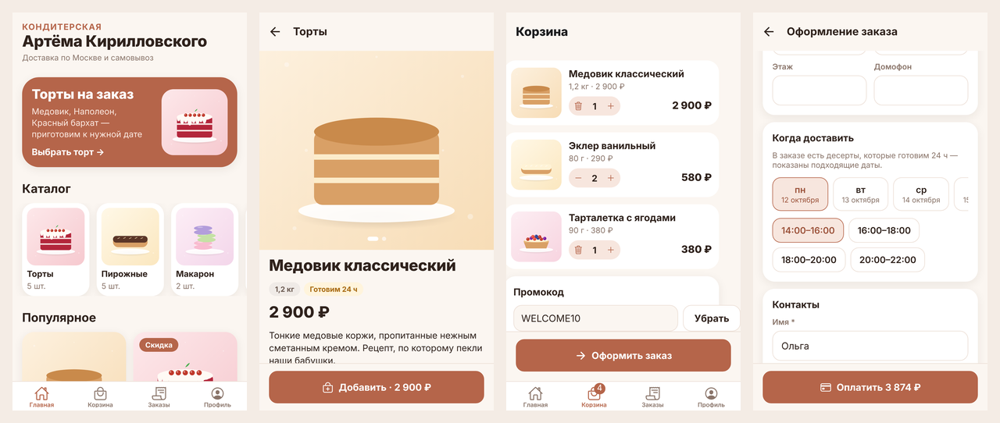
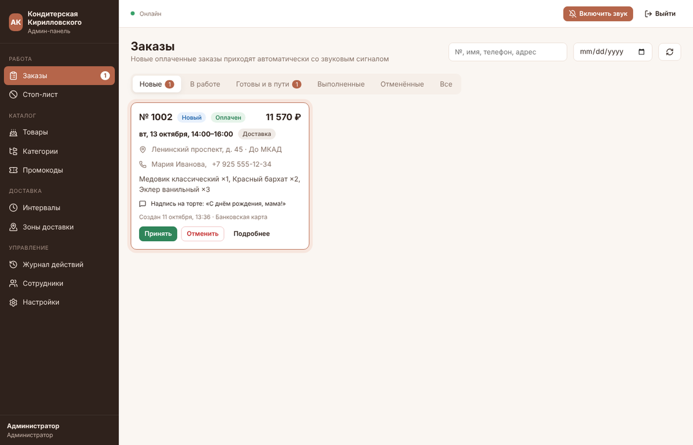
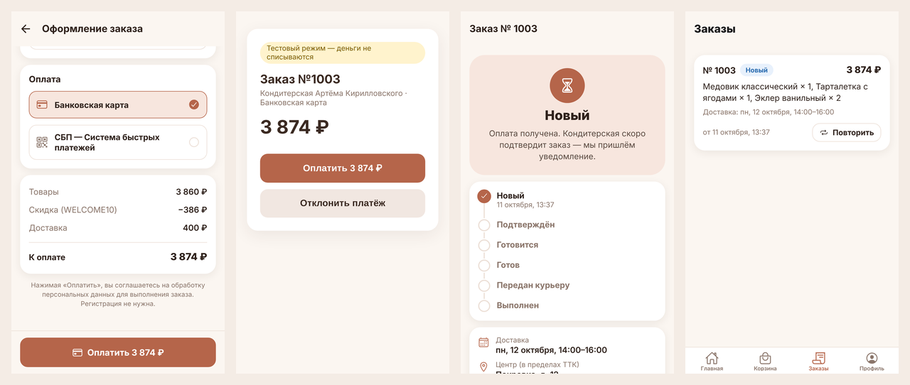
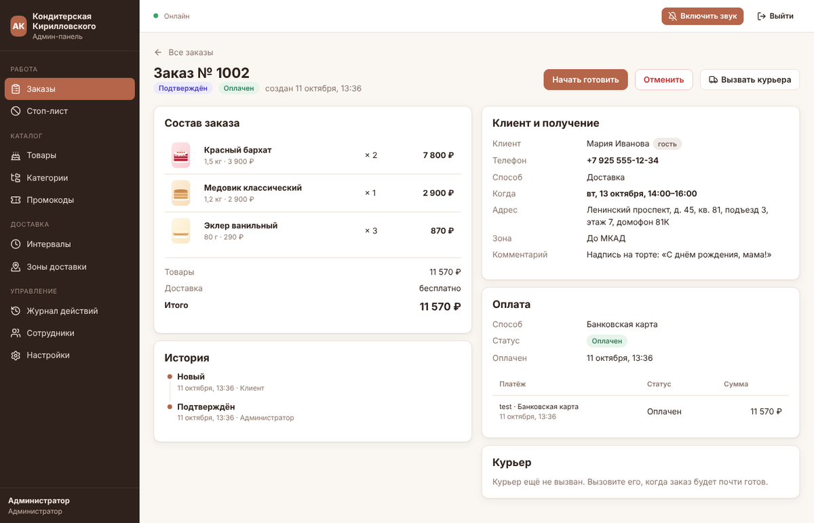

# Кондитерская Артёма Кирилловского

MVP сервиса заказа десертов для частных клиентов в Москве: мобильное приложение, админ-панель и API в одном monorepo.

- **Мобильное приложение** — React Native, Expo SDK 57, Expo Router, TypeScript.
- **Админ-панель** — Next.js 16, TypeScript.
- **API** — Node.js, NestJS 11, Prisma 6, PostgreSQL 16.
- **Интеграции** — отдельные адаптеры: Альфа-Банк / СБП, Яндекс Доставка, 1С:УНФ, Telegram, Expo Push. В первой версии работают тестовые платёжный и курьерский адаптеры.

Язык интерфейсов — русский, валюта — рубли, часовой пояс бизнес-логики — `Europe/Moscow`.

| Приложение | Админ-панель |
|---|---|
|  |  |
|  |  |

## Документация

1. [Архитектура](docs/01-architecture.md) — компоненты, модули API, адаптеры, сценарии, статусная машина.
2. [Схема базы данных](docs/02-database.md) — ER-диаграмма и описание таблиц.
3. [Экраны и переходы](docs/03-screens.md) — приложение и админ-панель.
4. [Этапы реализации](docs/04-roadmap.md) — что сделано в MVP и что дальше.
5. [Что делать дальше](docs/05-next-steps.md) — план по итогам аудита MVP: исправления, задачи владельца, этапы.
5. Swagger API — `http://localhost:4000/api/docs` после запуска.

## Структура

```
apps/
  api/        NestJS + Prisma: схема, миграции, сиды, модули, адаптеры интеграций
  admin/      Next.js: админ-панель
  mobile/     Expo: мобильное приложение (iOS, Android, web для отладки)
packages/
  shared/     общие типы, статусы, переходы, форматирование рублей и дат
docs/         архитектура, БД, экраны, этапы, скриншоты
docker-compose.yml   PostgreSQL + API + админ-панель
.env.example         все переменные окружения (без секретов)
```

## Быстрый старт (Docker)

Нужны Docker с Compose v2.24+ и Node.js 22 с pnpm (для мобильного приложения).

```bash
cp .env.example .env
docker compose up -d --build
```

При старте API сам применит миграции и загрузит демо-данные (идемпотентно, `SEED_ON_START=true`).

| Что | Адрес |
|---|---|
| Админ-панель | http://localhost:3000 |
| API | http://localhost:4000/api/v1 |
| Swagger | http://localhost:4000/api/docs |
| PostgreSQL | `localhost:5432`, пользователь, пароль и БД — `kirilovskiy` |

Вход в админ-панель: `admin@kirilovskiy.local` / пароль из `SEED_ADMIN_PASSWORD` (в `.env.example` — `admin12345`, только для разработки). Демо-сотрудники с тем же паролем: `manager@kirilovskiy.local` (менеджер), `operator@kirilovskiy.local` (оператор).

Остановить: `docker compose down`, удалить данные: `docker compose down -v`.

## Мобильное приложение

```bash
corepack enable          # pnpm из packageManager
pnpm install
pnpm dev:mobile          # Expo Dev Server; QR-код — для телефона
```

- **Адрес API.** Если `EXPO_PUBLIC_API_URL` пустой, приложение обращается к API на компьютере, где запущен Metro (`http://<IP компьютера>:4000`). Телефон и компьютер должны быть в одной Wi-Fi сети. Эмулятор Android использует `10.0.2.2`.
- **Expo Go.** Магазинная версия Expo Go поддерживает только последний SDK — проект на SDK 57. Каталог, корзина, оформление и оплата работают в Expo Go.
- **Push-уведомления** не работают в Expo Go на Android (с SDK 53) и на симуляторах. Для проверки push соберите development-сборку: `npx eas-cli init` (запишите id проекта в `EAS_PROJECT_ID`), затем `npx eas-cli build --profile development --platform android` или `pnpm --filter @kirilovskiy/mobile exec expo run:android`.
- **Web-версия для отладки:** `pnpm --filter @kirilovskiy/mobile web` → http://localhost:8081.

## Разработка без Docker

```bash
cp .env.example .env
pnpm install                 # заодно соберёт packages/shared и Prisma Client
pnpm db:up                   # только PostgreSQL в Docker (или свой PostgreSQL 16 и DATABASE_URL)
pnpm db:migrate              # миграции (prisma migrate dev)
pnpm db:seed                 # демо-данные
pnpm dev:api                 # http://localhost:4000, hot reload
pnpm dev:admin               # http://localhost:3000
pnpm dev:mobile              # Expo
```

Проверки (их же запускает CI в `.github/workflows/ci.yml`):

```bash
pnpm typecheck   # TypeScript во всех пакетах
pnpm test        # юнит-тесты: слоты, промокоды, расчёт цены, статусы, форматирование
pnpm build       # сборка shared, API и админ-панели
```

## Что попробовать

1. В приложении: главная → «Торты» → «Медовик» (готовим 24 ч — ближайшие даты отфильтруются) → в корзину.
2. Корзина: промокод `WELCOME10` (−10%, не больше 1 000 ₽) или `SWEET500` (−500 ₽ от 3 000 ₽). «Морковный торт» в стоп-листе — его нельзя заказать.
3. Оформление без регистрации: доставка или самовывоз, зона, адрес, дата и интервал, имя, телефон, комментарий, карта или СБП.
4. «Оплатить» открывает **тестовую страницу оплаты**: «Оплатить» или «Отклонить платёж». Неоплаченный заказ отменяется через 30 минут.
5. В админ-панели нажмите «Включить звук»: новый оплаченный заказ появится сам (SSE), со звуковым сигналом и подсветкой.
6. «Принять» → «Начать готовить» → «Вызвать курьера» (тестовый курьер сам пройдёт этапы «Передан курьеру» и «Выполнен» за ~3 минуты) или «Готов» → «Выполнен» для самовывоза. Каждое изменение приходит клиенту push-уведомлением (с `PUSH_PROVIDER=log` — в лог API).
7. «Отменить» с причиной — оплаченный заказ автоматически возвращается через платёжный адаптер.
8. В приложении: «Заказы» → «Повторить», «Профиль» → вход по номеру (в режиме разработки код показывается на экране) → «Удалить аккаунт».
9. Журнал действий в админ-панели показывает, кто и что менял: статусы, цены, стоп-лист, настройки.

## Переменные окружения

Полный список с комментариями — в [`.env.example`](.env.example). Основные:

| Переменная | Назначение | По умолчанию |
|---|---|---|
| `DATABASE_URL` | PostgreSQL для запуска API на хосте | `postgresql://kirilovskiy:…@localhost:5432/kirilovskiy` |
| `JWT_CUSTOMER_SECRET`, `JWT_STAFF_SECRET` | Подпись токенов клиентов и сотрудников (в production обязательны) | dev-значения |
| `API_PUBLIC_URL` | Публичный адрес API (callback банка) | `http://localhost:4000` |
| `CORS_ORIGINS` | Разрешённые origin через запятую | пусто — все (только dev) |
| `PAYMENT_PROVIDER` | `test` \| `alfabank` | `test` |
| `COURIER_PROVIDER` | `test` \| `yandex` | `test` |
| `ACCOUNTING_PROVIDER` | `noop` \| `onec` | `noop` |
| `PUSH_PROVIDER` | `log` \| `expo` | `log` |
| `TELEGRAM_BOT_TOKEN`, `TELEGRAM_CHAT_ID` | Уведомления сотрудникам (пусто — в лог) | пусто |
| `NEXT_PUBLIC_API_URL` | Адрес API для админ-панели (встраивается при сборке) | `http://localhost:4000` |
| `EXPO_PUBLIC_API_URL` | Адрес API для приложения | авто |
| `EAS_PROJECT_ID` | Проект EAS — для push-токенов и сборок | пусто |

## Интеграции

Каждая интеграция — интерфейс и реализации в `apps/api/src/modules/*/adapters`. Переключение — переменной окружения, без изменения кода заказов. Все вызовы пишутся в `integration_logs`, ошибка интеграции не ломает оформление заказа.

| Интеграция | Сейчас | Что нужно для боевого режима |
|---|---|---|
| **Альфа-Банк / СБП** (`PaymentAdapter`) | `test` — встроенная страница оплаты | Договор эквайринга, логин/пароль или токен API, `PAYMENT_PROVIDER=alfabank`. Каркас `alfabank-payment.adapter.ts` реализует `register.do`, ссылку СБП, `getOrderStatusExtended.do`, `refund.do` и проверку подписи callback — проверить на тестовом стенде `alfa.rbsuat.com`. Чеки 54-ФЗ — через банк или облачную кассу. |
| **Яндекс Доставка** (`CourierAdapter`) | `test` — эмулятор курьера | OAuth-токен кабинета, адрес и координаты кондитерской, `COURIER_PROVIDER=yandex`. Нужен геокодер для координат адреса клиента (этап 7). |
| **1С:УНФ** (`AccountingAdapter`) | `noop` — запись в журнал | HTTP-сервис в базе 1С (`/hs/kirilovskiy/orders`, `/catalog`), `ONEC_*`, `ACCOUNTING_PROVIDER=onec`. Номенклатура связывается по полю «Код номенклатуры 1С». |
| **Telegram** (`StaffNotifier`) | лог | Бот через @BotFather, `TELEGRAM_BOT_TOKEN`, id чата сотрудников в `TELEGRAM_CHAT_ID`. |
| **Expo Push** (`PushAdapter`) | лог | `PUSH_PROVIDER=expo`; в приложении — `EAS_PROJECT_ID`, ключ APNs и FCM v1 загружаются в EAS (`eas credentials`). |
| **SMS-коды** (`SmsAdapter`) | лог, код виден в приложении в dev | Подключить SMS.ru / SMSC / МТС Exolve (этап 5). В production код не возвращается. |

## Публикация

### API и админ-панель

1. Сервер или managed-сервисы в РФ (152-ФЗ): Yandex Cloud, Selectel, VK Cloud. PostgreSQL — managed с бэкапами.
2. Переменные: `NODE_ENV=production`, длинные случайные `JWT_*` (`openssl rand -base64 48`), `POSTGRES_PASSWORD`, `API_PUBLIC_URL=https://api.<домен>`, `CORS_ORIGINS=https://admin.<домен>`, пустой `SEED_ADMIN_PASSWORD` (пароль сгенерируется и выведется в лог один раз), `SEED_DEMO_DATA=false`.
3. Сборка образов: `docker compose build` (или `docker build -f apps/api/Dockerfile .` и `docker build -f apps/admin/Dockerfile --build-arg NEXT_PUBLIC_API_URL=https://api.<домен> .`).
4. HTTPS — через обратный прокси (Caddy, Nginx, балансировщик облака). API выполняет миграции при старте контейнера.
5. Фото товаров хранятся в томе `uploads`. Для нескольких экземпляров API замените `StorageService` на S3-совместимое хранилище.
6. Мониторинг: `GET /api/v1/health`, логи контейнеров, Sentry (этап 6).

### Мобильное приложение (EAS)

```bash
cd apps/mobile
npx eas-cli login
npx eas-cli init                                   # id проекта → EAS_PROJECT_ID
# в eas.json укажите боевой EXPO_PUBLIC_API_URL для профиля production
npx eas-cli build --profile production --platform all
npx eas-cli submit --platform ios                  # App Store Connect
npx eas-cli submit --platform android              # Google Play
```

- Идентификатор приложения — `ru.kirilovskiy.bakery` (меняется в `app.config.ts`).
- Для App Store и Google Play нужны: политика конфиденциальности (ссылка — в «Настройках» админ-панели), удаление аккаунта внутри приложения (есть), анкеты Data safety / App Privacy. Google Play также требует веб-страницу с запросом удаления аккаунта.
- RuStore принимает AAB/APK из той же сборки EAS.
- Обновления JS без публикации в сторах — `npx eas-cli update` (EAS Update).

## Ограничения MVP

- Боевые адаптеры Альфа-Банка, Яндекс Доставки и 1С написаны по документации, но не проверены на реальных учётных записях.
- Зону доставки клиент выбирает из списка; автоопределение по адресу и карта — на этапе 7.
- SMS не отправляются: в режиме разработки код показывается в приложении.
- Токен сотрудника хранится в `localStorage` админ-панели; для production стоит перейти на httpOnly-cookie.
- Используются стабильные мажорные версии NestJS 11 и Prisma 6; переход на NestJS 12 (ESM) и Prisma 7 — отдельной задачей.
