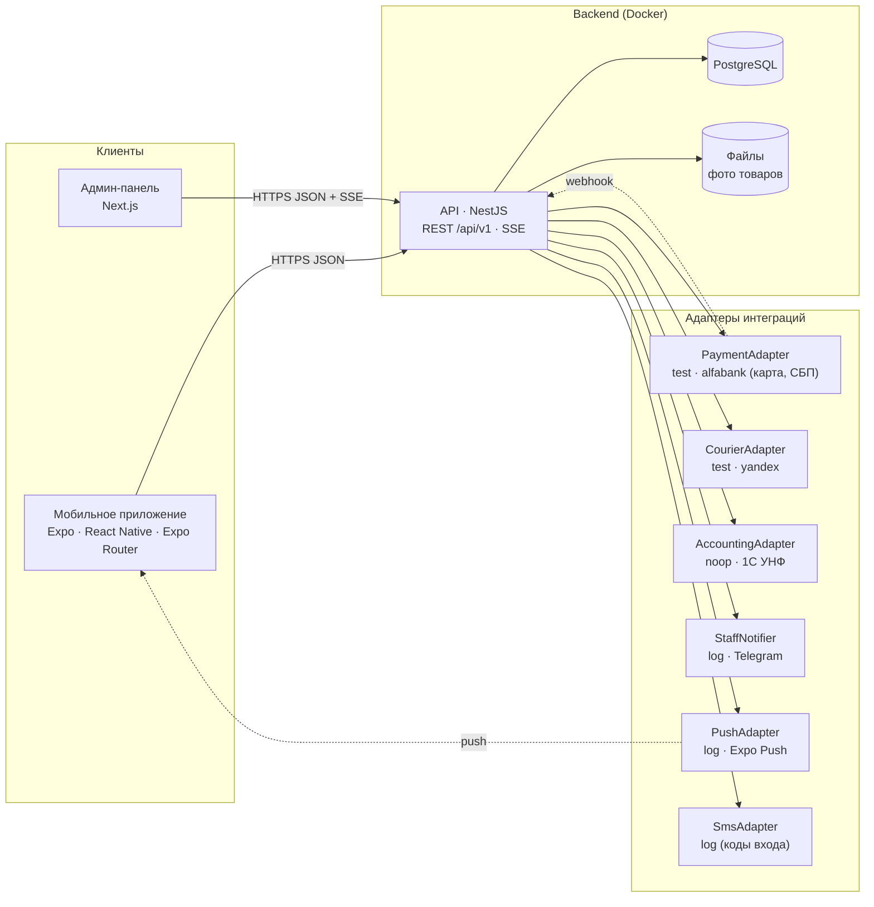
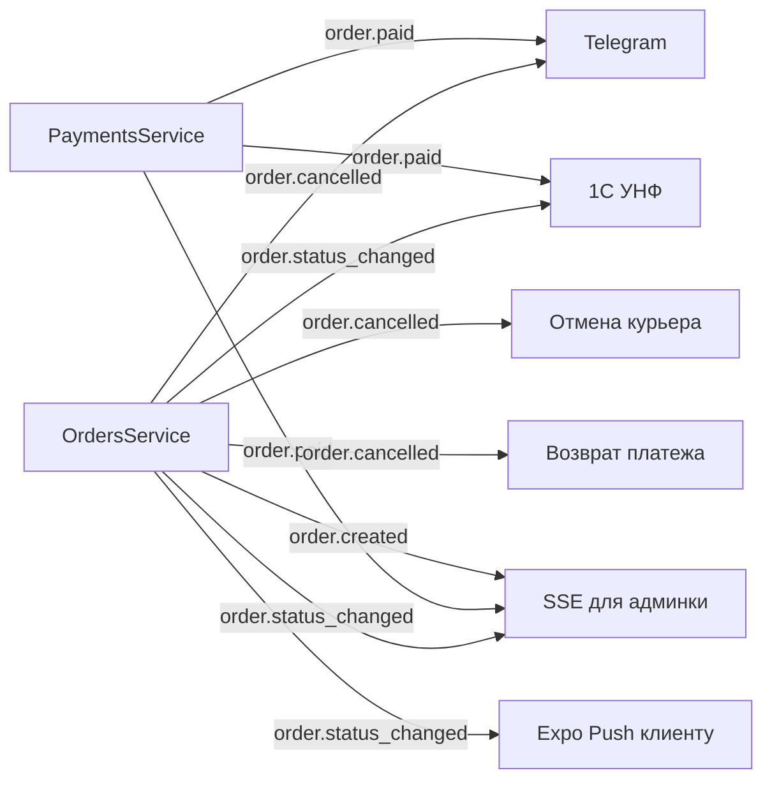
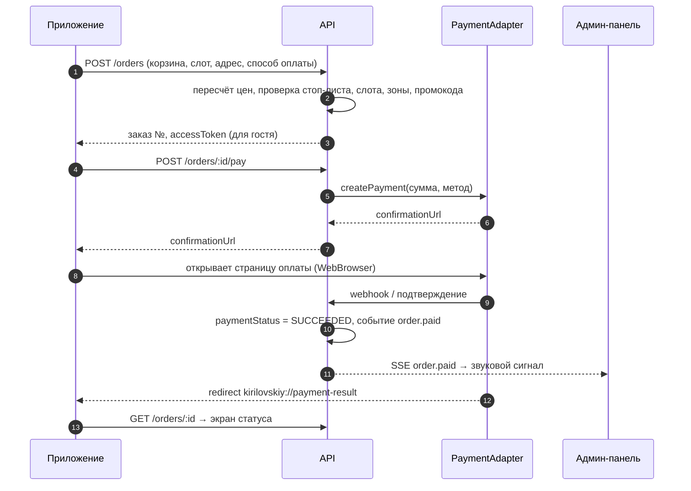
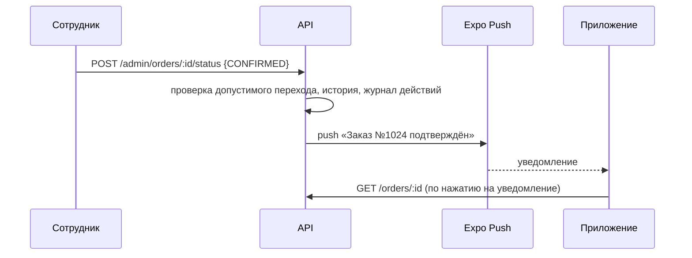
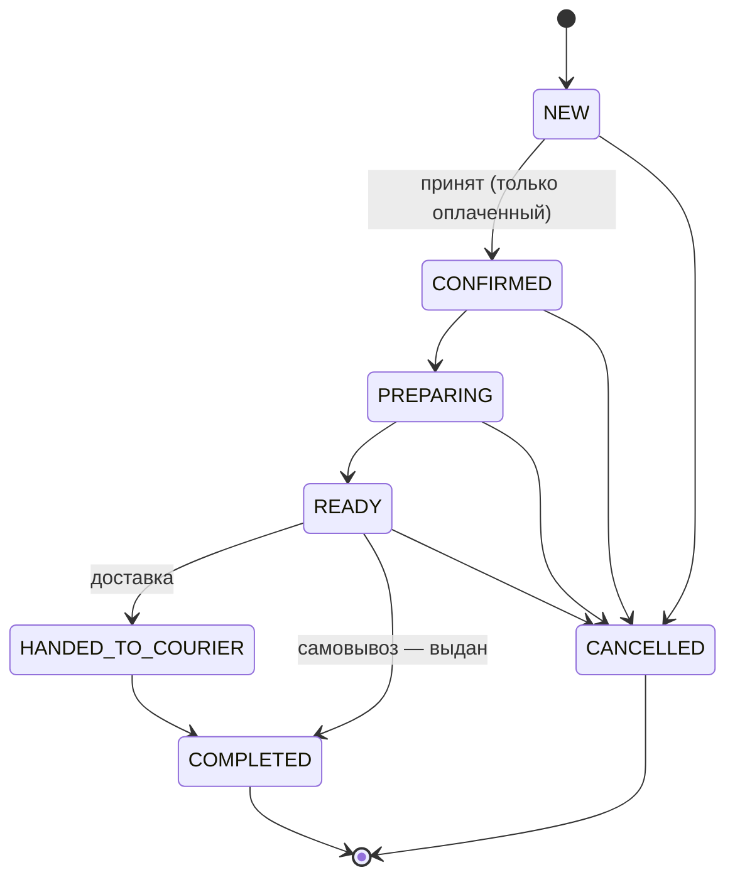

# 1. Архитектура

## 1.1. Общая схема



| Слой | Технология | Назначение |
|---|---|---|
| Мобильное приложение | Expo SDK 57, React Native 0.86, Expo Router, TypeScript, TanStack Query, Zustand | Каталог, корзина, оформление, оплата, статус заказа, push, история |
| Админ-панель | Next.js 16 (App Router), TypeScript, клиентские компоненты | Работа с заказами, каталогом, стоп-листом, слотами, зонами, промокодами, журналом |
| API | NestJS 11, Prisma 6, class-validator, Swagger, EventEmitter, Schedule | Бизнес-логика, расчёт цены, слоты, статусы, интеграции |
| БД | PostgreSQL 16 | Единый источник данных |
| Общий пакет | `@kirilovskiy/shared` (TypeScript) | Статусы, подписи на русском, переходы статусов, форматирование рублей и дат, типы API |
| Инфраструктура | pnpm workspaces, Docker Compose | Monorepo и локальный запуск одной командой |

## 1.2. Структура monorepo

```
kirilovskiy-app/
├── apps/
│   ├── api/            NestJS + Prisma (схема, миграции, сиды)
│   ├── admin/          Next.js админ-панель
│   └── mobile/         Expo-приложение
├── packages/
│   └── shared/         общие типы, константы и утилиты
├── docs/               архитектура, БД, экраны, этапы
├── docker-compose.yml  postgres + api + admin
└── .env.example        шаблон переменных окружения (без секретов)
```

## 1.3. Модули API

| Модуль | Ответственность |
|---|---|
| `auth` | Вход клиента по телефону и SMS-коду (JWT), вход сотрудника по email и паролю (JWT), guards и роли |
| `account` | Профиль клиента, устройства для push, **удаление аккаунта** |
| `catalog` | Категории, товары, фото, аллергены, стоп-лист (публичные и админские эндпоинты) |
| `delivery` | Зоны доставки, временные интервалы, нерабочие дни, расчёт доступных слотов |
| `promo` | Промокоды и проверка скидки |
| `pricing` | Серверный расчёт корзины: сумма, доставка, скидка, итог, проверки минимальной суммы |
| `orders` | Создание заказа (гость или клиент), статусная машина, история, повтор, SSE-поток для админки |
| `payments` | Платёжный шлюз поверх `PaymentAdapter`, webhook, тестовая страница оплаты, возвраты |
| `courier` | Вызов курьера через `CourierAdapter` (Яндекс Доставка) |
| `accounting` | Выгрузка заказов в 1С УНФ через `AccountingAdapter` |
| `notifications` | Push клиенту (Expo), сообщения сотрудникам (Telegram), журнал уведомлений |
| `audit` | Журнал действий сотрудников |
| `staff` | Управление сотрудниками |
| `settings` | Настройки магазина: адрес самовывоза, минимальная сумма, время на подготовку, приём заказов |
| `uploads` | Хранение фото (локальный диск, легко заменить на S3-совместимое хранилище) |

Модули общаются через доменные события (`@nestjs/event-emitter`):



Благодаря этому интеграции не блокируют оформление заказа: ошибка Telegram или 1С записывается в `integration_logs` и не ломает ответ клиенту.

## 1.4. Адаптеры интеграций

Каждая интеграция — это интерфейс и несколько реализаций. Реализация выбирается переменной окружения.

| Интеграция | Интерфейс | Реализации | Переменная |
|---|---|---|---|
| Альфа-Банк / СБП | `PaymentAdapter` | `test` (встроенная страница оплаты), `alfabank` (каркас под REST API Альфа-Банка: `register.do`, `getOrderStatusExtended.do`, `refund.do`, СБП через QR) | `PAYMENT_PROVIDER` |
| Яндекс Доставка | `CourierAdapter` | `test` (эмулятор курьера), `yandex` (каркас под API «claims» v2) | `COURIER_PROVIDER` |
| 1С УНФ | `AccountingAdapter` | `noop` (только журнал), `onec` (HTTP-сервис 1С с Basic Auth) | `ACCOUNTING_PROVIDER` |
| Telegram | `StaffNotifier` | `log`, `telegram` (Bot API `sendMessage`) | `TELEGRAM_BOT_TOKEN` пустой → `log` |
| Expo Push | `PushAdapter` | `log`, `expo` (`https://exp.host/--/api/v2/push/send`) | `PUSH_PROVIDER` |
| SMS (коды входа) | `SmsAdapter` | `log` (код в логах, в dev-режиме возвращается в ответе) | `SMS_PROVIDER` |

В первой версии по умолчанию включены тестовые платёжный и курьерский адаптеры. Ключи боевых сервисов в репозиторий не попадают: только `.env.example` с пустыми значениями.

## 1.5. Ключевые сценарии

### Оформление и оплата заказа



### Смена статуса и push



## 1.6. Статусная машина заказа



| Код | Название | Кто переводит |
|---|---|---|
| `NEW` | Новый | Создаётся при оформлении |
| `CONFIRMED` | Подтверждён | Сотрудник («Принять») |
| `PREPARING` | Готовится | Сотрудник |
| `READY` | Готов | Сотрудник |
| `HANDED_TO_COURIER` | Передан курьеру | Сотрудник или статус курьерской службы |
| `COMPLETED` | Выполнен | Сотрудник или курьерская служба |
| `CANCELLED` | Отменён | Сотрудник (с причиной) или система (неоплаченный заказ по таймауту) |

При отмене оплаченного заказа API делает возврат через `PaymentAdapter` и отменяет заявку курьеру, если она была.

## 1.7. Безопасность и персональные данные

- Клиент может оформить заказ **без регистрации**: API возвращает `accessToken` заказа, приложение хранит его локально и по нему показывает статус и историю гостевых заказов.
- Аккаунт создаётся по номеру телефона и коду из SMS. **Удаление аккаунта** доступно в профиле: персональные данные стираются, в завершённых заказах обезличиваются имя, телефон и адрес (суммы остаются для бухгалтерии). Пока есть активный заказ, удаление недоступно, приложение объясняет причину.
- Сотрудники входят по email и паролю (bcrypt), роли: `ADMIN`, `MANAGER`, `OPERATOR`.
- Все цены и скидки считаются на сервере; клиент присылает только `productId` и количество.
- Токен гостевого заказа хранится в БД в виде SHA-256-хэша.
- Секреты только в переменных окружения, `.env` в `.gitignore`.
- Персональные данные клиентов хранятся в РФ (требование 152-ФЗ) — учесть при выборе хостинга.

## 1.8. Время, деньги, язык

- Все суммы хранятся в **копейках** (`Int`), отображаются в рублях: `1 250 ₽`.
- Часовой пояс бизнес-логики — `Europe/Moscow`: «сегодня», слоты, время на подготовку, нерабочие дни считаются по московскому времени. В БД моменты времени хранятся в UTC, дата доставки — как `date`.
- Интерфейсы, push и сообщения об ошибках API — на русском языке.
