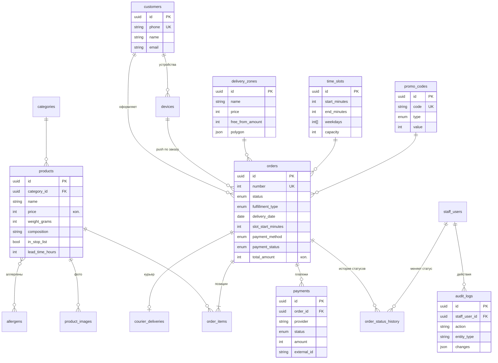

# 2. Схема базы данных

Источник истины — [`apps/api/prisma/schema.prisma`](../apps/api/prisma/schema.prisma), SQL-миграции — в `apps/api/prisma/migrations`.

Соглашения:
- первичные ключи — UUID; у заказа дополнительно человекочитаемый `number` (с 1001);
- деньги — `Int` в копейках;
- моменты времени — `timestamptz`-подобные `DateTime` в UTC; дата доставки — `date` (день по Москве), интервал — минуты от полуночи по Москве;
- имена таблиц и колонок — `snake_case`.

## 2.1. ER-диаграмма

## 2.2. Таблицы

### Клиенты

| Таблица | Назначение | Важные поля |
|---|---|---|
| `customers` | Зарегистрированные клиенты (вход по телефону) | `phone` (уникальный, `+7XXXXXXXXXX`), `name`, `email` |
| `auth_codes` | Одноразовые SMS-коды | `code_hash`, `expires_at`, `attempts` (не более 5), `consumed_at` |
| `devices` | Устройства с Expo push-токеном; есть и у гостей | `expo_push_token` (уникальный), `platform`, `customer_id` (nullable) |

### Каталог

| Таблица | Назначение | Важные поля |
|---|---|---|
| `categories` | Категории десертов | `slug`, `sort_order`, `is_active` |
| `products` | Товары | `price`, `old_price`, `weight_grams`, `composition`, КБЖУ, `storage_conditions`, `lead_time_hours` (торт на заказ — 24–48 ч), `is_featured`, **стоп-лист**: `in_stop_list`, `stop_list_reason`, `stop_list_until`; `external_id` — GUID номенклатуры 1С; `archived_at` — мягкое удаление |
| `product_images` | Фотографии товара | `url`, `sort_order` (первое фото — обложка) |
| `allergens` + `_ProductAllergens` | Справочник аллергенов и связь M:N | `code` (`gluten`, `milk`, `eggs`, `nuts`…), `name` |

### Доставка

| Таблица | Назначение | Важные поля |
|---|---|---|
| `delivery_zones` | Зоны доставки | `price`, `free_from_amount`, `min_order_amount`, `estimated_minutes`, `polygon` (GeoJSON, для автоопределения) |
| `time_slots` | Шаблоны интервалов | `fulfillment_type` (null — для обоих способов), `start_minutes`/`end_minutes`, `weekdays` (1–7), `capacity` |
| `blackout_dates` | Нерабочие дни | `date`, `reason` |

Доступность интервала на дату вычисляется: день не в `blackout_dates`, день недели входит в `weekdays`, начало интервала не раньше «сейчас + время на подготовку» (максимум из настройки магазина и `lead_time_hours` товаров корзины), число неотменённых заказов на эту дату и интервал меньше `capacity`.

### Заказы и оплата

| Таблица | Назначение | Важные поля |
|---|---|---|
| `orders` | Заказы | `number`, `status`, `access_token_hash` (доступ гостя), контакты, адрес, `delivery_date` + интервал (снимок минут), `payment_method`, `payment_status`, суммы (`subtotal`, `delivery`, `discount`, `total`), промокод (снимок), `cancel_reason`, `accounting_id` (1С), отметки времени по этапам |
| `order_items` | Позиции | снимок `product_name`, `unit_price`, `weight_grams`, `image_url`; `product_id` → `SET NULL` при удалении товара |
| `order_status_history` | История смены статусов | `from_status`, `to_status`, `actor` (клиент / сотрудник / система / интеграция), `staff_user_id`, `comment` |
| `payments` | Платежи через адаптер | `provider`, `method`, `status`, `amount`, `refunded_amount`, `external_id`, `confirmation_url`, `raw` |
| `courier_deliveries` | Заявка курьерской службе | `provider`, `external_id`, `status`, `price`, `tracking_url`, данные курьера |

### Промокоды

| Таблица | Назначение | Важные поля |
|---|---|---|
| `promo_codes` | Скидки | `code` (верхний регистр), `type` (`PERCENT`/`FIXED`), `value`, `min_order_amount`, `max_discount_amount`, период действия, `usage_limit`, `usage_limit_per_customer`, `used_count` |

### Сотрудники, журналы, настройки

| Таблица | Назначение | Важные поля |
|---|---|---|
| `staff_users` | Сотрудники админ-панели | `email`, `password_hash` (bcrypt), `role` |
| `audit_logs` | **История действий сотрудников** | `action` (`order.status`, `product.update`…), `entity_type`/`entity_id`, `summary` на русском, `changes` (было → стало), `ip` |
| `notification_logs` | Журнал push / Telegram / SMS | `channel`, `recipient`, `status`, `error` |
| `integration_logs` | Журнал обращений к банку, доставке, 1С | `provider`, `operation`, `success`, `request`/`response`, `duration_ms` |
| `settings` | Настройки магазина (key → JSON) | ключ `store`: адрес самовывоза, телефон, минимальная сумма заказа, время на подготовку, горизонт дат, таймаут оплаты, флаг «принимаем заказы» |

## 2.3. Индексы

- `orders(status, created_at)` — список новых и текущих заказов в админке;
- `orders(delivery_date, time_slot_id)` — подсчёт загрузки интервала;
- `orders(customer_id, created_at)` — история заказов клиента;
- `audit_logs(created_at)`, `audit_logs(entity_type, entity_id)`, `audit_logs(staff_user_id, created_at)` — фильтры журнала;
- `payments(provider, external_id)` уникальный — идемпотентная обработка webhook.

## 2.4. Удаление аккаунта

1. Проверяется, что у клиента нет активных заказов (`NEW` … `HANDED_TO_COURIER`).
2. В его заказах имя заменяется на «Удалённый клиент», телефон, адрес, координаты и комментарий очищаются, связь `customer_id` обнуляется. Суммы и состав остаются для учёта.
3. Устройства отвязываются (push-токены удаляются), запись `customers` удаляется.
