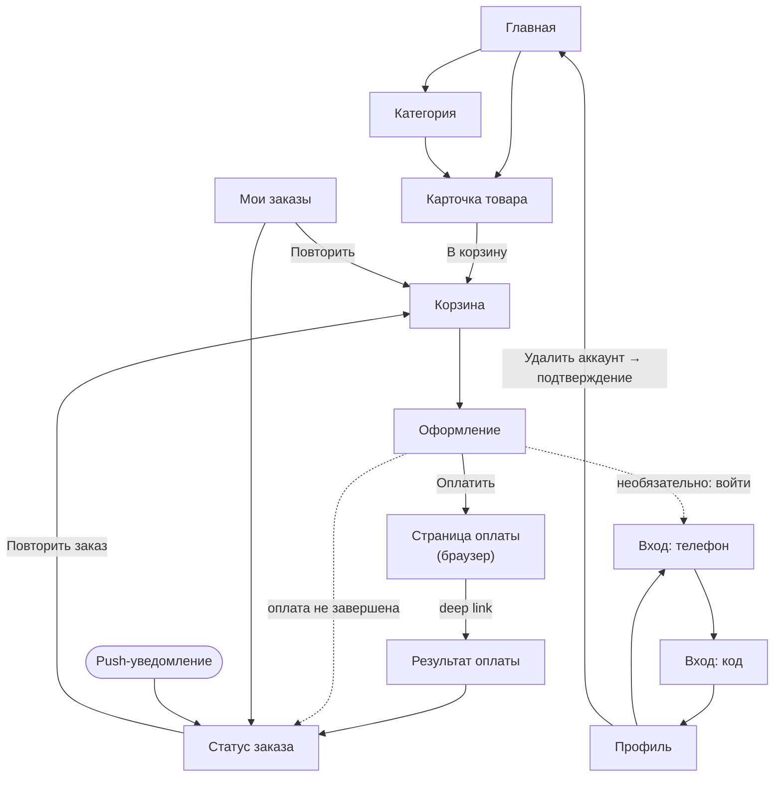
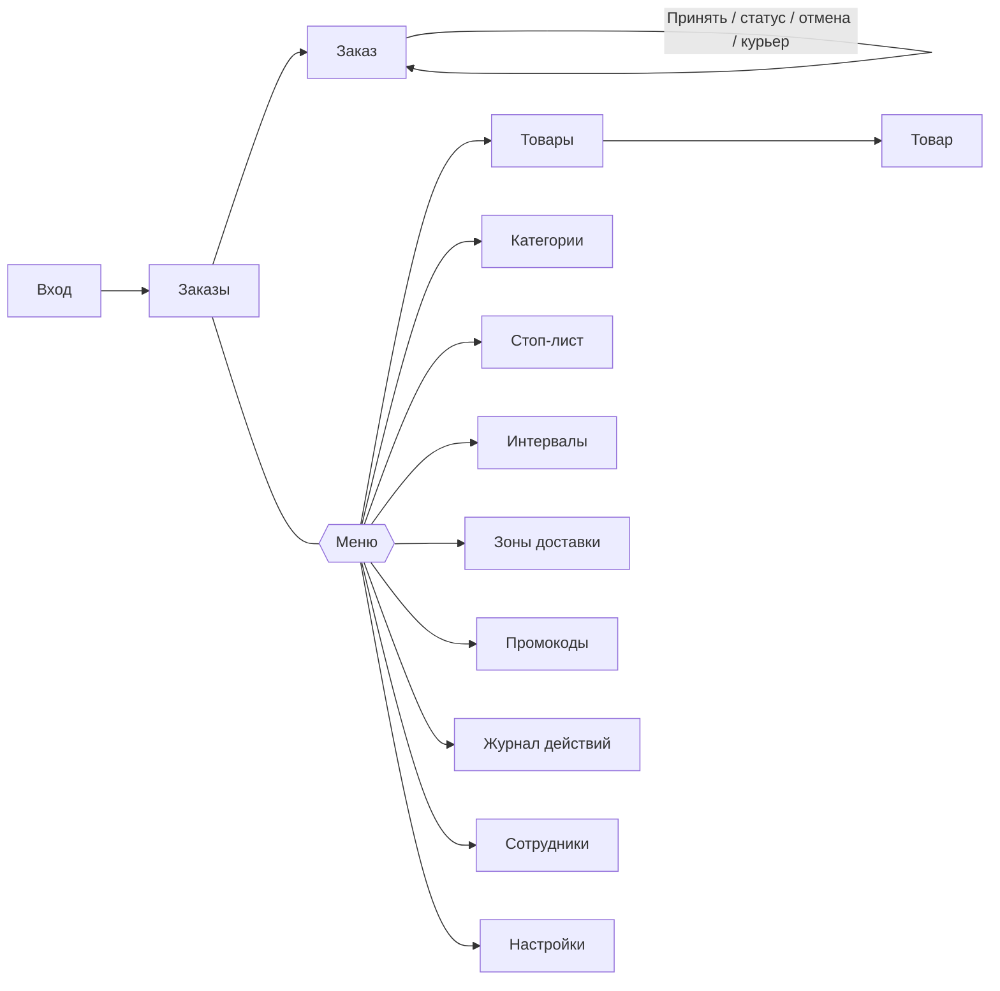

# 3. Экраны и переходы

## 3.1. Мобильное приложение

Навигация — Expo Router (файловая маршрутизация, `apps/mobile/src/app`). Нижняя панель вкладок: **Главная · Корзина · Заказы · Профиль**.

| № | Экран | Маршрут | Что на экране |
|---|---|---|---|
| 1 | Главная | `/(tabs)` | Приветствие, баннер, категории (горизонтальный список), «Популярное», переход в категорию |
| 2 | Категория | `/category/[slug]` | Сетка товаров: фото, название, вес, цена, кнопка «+» / счётчик; товары из стоп-листа помечены «Нет в наличии» |
| 3 | Карточка товара | `/product/[id]` | Галерея фото (листание), цена и старая цена, вес, описание, **состав**, **аллергены**, КБЖУ, условия хранения, срок изготовления, кнопка «В корзину» и изменение количества |
| 4 | Корзина | `/(tabs)/cart` | Позиции с изменением количества и удалением, промокод, серверный расчёт суммы, предупреждение о недоступных товарах, «Оформить заказ» |
| 5 | Оформление | `/checkout` | Доставка / самовывоз; зона доставки; адрес (улица и дом, квартира, подъезд, этаж, домофон); дата (ближайшие дни) и интервал; имя, телефон, комментарий; оплата: карта или СБП; согласие на обработку данных; итог и кнопка «Оплатить» |
| 6 | Оплата | системный браузер (`expo-web-browser`) | Страница платёжного адаптера; возврат через `kirilovskiy://payment-result` |
| 7 | Результат оплаты | `/payment-result` | Проверка статуса оплаты и переход к заказу |
| 8 | Статус заказа | `/order/[id]` | Номер, текущий статус и шкала этапов, дата и интервал, адрес / точка самовывоза, состав, суммы, статус оплаты, кнопки «Оплатить» (если не оплачен) и «Повторить заказ»; обновляется по push и опросом |
| 9 | Мои заказы | `/(tabs)/orders` | История: заказы аккаунта и гостевые заказы с этого устройства; статус, сумма, дата; «Повторить» |
| 10 | Профиль | `/(tabs)/profile` | Гость: «Войти по номеру телефона», настройки уведомлений, контакты. Клиент: имя, телефон, email, «Выйти», **«Удалить аккаунт»** |
| 11 | Вход: телефон | `/auth/phone` | Ввод номера `+7`, отправка кода |
| 12 | Вход: код | `/auth/code` | Ввод 4-значного кода, повторная отправка через 60 с |
| 13 | Не найдено | `+not-found` | Ссылка на главную |

### Переходы

Оформление заказа без регистрации — основной сценарий: вход в аккаунт нигде не обязателен. После входа гостевые заказы этого устройства остаются в истории.

## 3.2. Админ-панель

| № | Экран | Маршрут | Что на экране | Роли |
|---|---|---|---|---|
| 1 | Вход | `/login` | Email и пароль | все |
| 2 | Заказы | `/orders` | Вкладки «Новые», «В работе», «Готовы», «Все», «Отменённые»; карточки с номером, суммой, оплатой, датой и интервалом; **звуковой сигнал** и подсветка при новом оплаченном заказе (SSE + резервный опрос); кнопки «Принять» / «Отменить» | все |
| 3 | Заказ | `/orders/[id]` | Состав, клиент, адрес, интервал, оплата, курьер; кнопки перехода по статусам, отмена с причиной, «Вызвать курьера»; история статусов | все |
| 4 | Товары | `/products` | Поиск, фильтр по категории, цена, стоп-лист, публикация | ADMIN, MANAGER |
| 5 | Товар | `/products/new`, `/products/[id]` | Поля товара, аллергены, загрузка и порядок фото | ADMIN, MANAGER |
| 6 | Категории | `/categories` | Список с порядком, создание, редактирование, скрытие | ADMIN, MANAGER |
| 7 | Стоп-лист | `/stop-list` | Быстрое включение и выключение товаров, причина, «до конца дня» | все |
| 8 | Интервалы | `/delivery/slots` | Временные интервалы, дни недели, вместимость, нерабочие дни | ADMIN, MANAGER |
| 9 | Зоны доставки | `/delivery/zones` | Стоимость, бесплатно от суммы, минимальный заказ | ADMIN, MANAGER |
| 10 | Промокоды | `/promo-codes` | Создание, срок, лимиты, статистика использования | ADMIN, MANAGER |
| 11 | Журнал действий | `/audit` | История действий сотрудников с фильтрами | ADMIN, MANAGER |
| 12 | Сотрудники | `/staff` | Создание, роли, блокировка | ADMIN |
| 13 | Настройки | `/settings` | Адрес самовывоза, телефон, минимальная сумма, время на подготовку, приём заказов | ADMIN |

